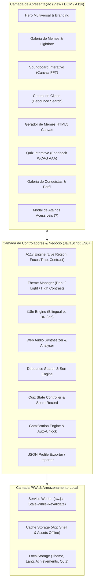
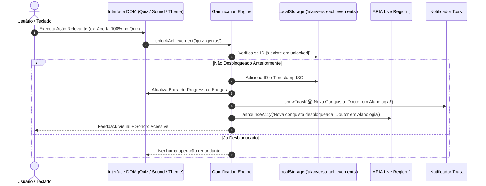
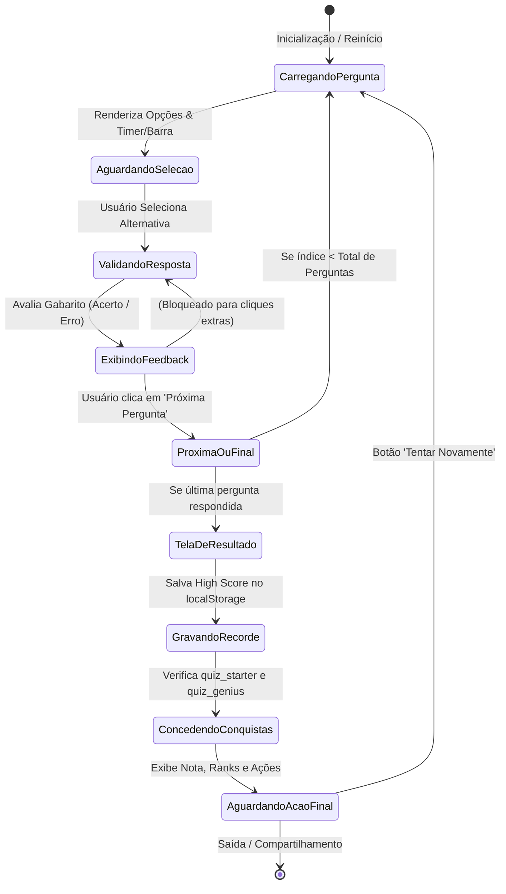
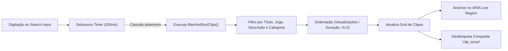
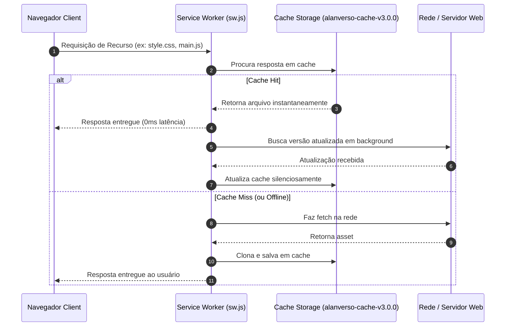

# 🏛️ Arquitetura do Sistema — Alanverso v3.0.0

Este documento apresenta a especificação arquitetural completa do **Alanverso**, detalhando padrões de design front-end, ciclo de vida de componentes reativos, engenharia de som via Web Audio API, sistema de gamificação client-side com persistência, máquina de estados do Quiz, barramento de eventos, conformidade de acessibilidade (WCAG 2.2 AAA) e estratégias de PWA (Service Worker e Cache Offline).

---

## 1. Visão Geral em Camadas

A arquitetura do Alanverso é orientada a padrões modernos de Single Page Application (SPA) em Vanilla Web (ES6+), priorizando alta performance, independência de frameworks pesados, manutenibilidade e desacoplamento entre apresentação, regras de negócio e persistência.



---

## 2. Diagrama de Sequência: Ciclo de Conquistas e Persistência

O sistema de gamificação rastreia ações do usuário e sincroniza troféus em tempo real com anúncios auditivos (WCAG AAA) e persistência no `localStorage`.



---

## 3. Máquina de Estados do Quiz Interativo

O módulo de Quiz opera como uma máquina de estados finitos que valida cada rodada, previne respostas duplicadas e calcula o aproveitamento final.



---

## 4. Pipeline de Busca Instantânea com Debounce

A busca de clipes utiliza técnica de debounce para garantir fluidez extrema e não sobrecarregar o renderizador do DOM, mantendo acessibilidade total para tecnologias assistivas.



---

## 5. Estratégia de PWA & Service Worker (Offline-First)

O Service Worker implementa a estratégia **Stale-While-Revalidate** para navegação e **Cache-First** para assets estáticos locais:



---

## 6. Matriz de Acessibilidade (WCAG 2.2 AAA)

| Critério WCAG | Requisito Técnico | Implementação no Alanverso |
| :--- | :--- | :--- |
| **1.4.6 Contraste (Avançado)** | Proporção de contraste mínima de 7:1 para texto normal e 4.5:1 para texto grande. | Tema escuro refinado e modo `data-contrast="high"` com contraste ultra elevado (#ffff00 sobre #000000). |
| **2.1.1 Teclado** | Todas as funcionalidades acessíveis por teclado sem traps. | Foco visível com `outline: 3px solid var(--base-color)`, skip-links para todas as seções e navegação completa via `Tab`, `Space`, `Enter` e atalhos globais (`?`, `/`, `T`, `C`, `L`, `Esc`). |
| **2.4.1 Ignorar Blocos** | Mecanismo para pular navegação repetitiva. | `<nav class="skip-links">` no topo do documento apontando para cada seção principal. |
| **3.1.2 Idioma das Partes** | Identificação semântica do idioma de exibição. | Atributo `lang="pt-BR"` ou `lang="en"` dinâmico com i18n completo. |
| **4.1.3 Mensagens de Status** | Notificações perceptíveis para tecnologias assistivas. | Região `#a11y-live-region` com `aria-live="polite"` e `aria-atomic="true"`. |

---

## 7. Estrutura Modular de Diretórios

```
Alanverso/
├── .github/
│   └── workflows/
│       └── ci.yml                 # Pipeline CI/CD GitHub Actions
├── tests/
│   ├── dom.test.js                # Wrapper runner para testes DOM
│   ├── responsive.test.js         # Wrapper runner para testes de responsividade
│   ├── features.test.js           # Suite de testes para novos recursos (PWA, Quiz, Gamificação)
│   ├── test_dom.js                # Testes de integridade do DOM e acessibilidade
│   └── test_responsive.js         # Validações de media queries e viewport
├── favicon.svg                    # Favicon vetorial PWA
├── index.html                     # Entrypoint da aplicação SPA
├── i18n.js                        # Motor bilíngue de internacionalização
├── main.js                        # Controladores, Web Audio, Quiz, Conquistas e Debounce
├── manifest.json                  # PWA Web App Manifest
├── style.css                      # Design system, temas e acessibilidade AAA
├── sw.js                          # Service Worker com cache offline
├── package.json                   # Metadados e scripts de teste
├── ARCHITECTURE.md                # Documentação técnica e diagramas Mermaid
├── CHANGELOG.md                   # Histórico semântico de versões
├── CONTRIBUTING.md                # Guia de contribuição da comunidade
├── LICENSE                        # Licença MIT
└── README.md                      # Documentação oficial do projeto
```
