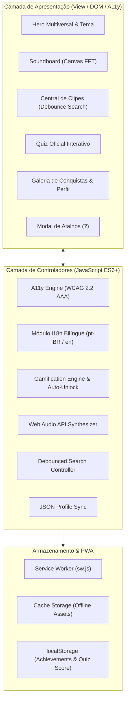

# 🌌 Alanverso — O Multiverso Definitivo do Alanzoka

<p align="center">
  
</p>

<p align="center">
  
  
  
  
  
  
  
</p>

---

## 📖 Visão Geral

O **Alanverso** é uma plataforma web interativa, responsiva e bem-humorada criada em homenagem ao streamer brasileiro **Alanzoka (Alan Ferreira)**. O projeto reúne os momentos históricos das lives, a lendária risada em ritmo de metralhadora, o Soundboard sintetizado com Web Audio API, central de vídeos, gerador de memes em Canvas HTML5, quiz oficial da lore, galeria de conquistas com persistência, PWA offline e suporte bilíngue (Português e Inglês).

A aplicação segue padrões de engenharia de software de altíssimo nível, arquitetura modular e conformidade máxima com as diretrizes de acessibilidade **WCAG 2.2 AAA**.

---

## 🚀 Novos Recursos & Destaques da Versão 3.0.0

| Recurso | Descrição |
| :--- | :--- |
| 🏆 **Sistema de Conquistas (Gamificação)** | 10 medalhas desbloqueáveis sincronizadas no `localStorage` sob `'alanverso-achievements'` com status dinâmico (de Iniciante a Lenda Suprema). |
| 🧠 **Quiz Interativo Oficial** | Desafio com 6 perguntas dinâmicas sobre variantes e lore, gabarito instantâneo, cálculo percentual e persistência do recorde (High Score). |
| 🔍 **Busca de Clipes com Debounce** | Filtragem instantânea por texto com debounce (250ms), ordenação por visualizações, duração ou ordem alfabética e feedback via ARIA Live. |
| 💾 **Exportação & Importação JSON** | Download e upload do perfil com conquistas e pontuações em formato JSON padronizado para backup e portabilidade. |
| 📲 **Progressive Web App (PWA)** | Manifesto (`manifest.json`) instalável e Service Worker (`sw.js`) com estratégia Stale-While-Revalidate para funcionamento offline. |
| 👁️ **Acessibilidade WCAG 2.2 AAA** | Modo de Alto Contraste (`data-contrast="high"`), guia de atalhos de teclado (`#shortcuts-modal`, tecla `?`), anéis de foco de 3px e skip links para todas as seções. |
| 🎹 **Soundboard Web Audio API** | Síntese de áudio em tempo real com osciladores e visualizador de espectro/ondas em Canvas. |
| 🎨 **Gerador de Memes HTML5 Canvas** | Customização completa de legendas, cores, fontes, upload de imagens e download em PNG de alta resolução. |
| 🌐 **Internacionalização Dinâmica (i18n)** | Suporte completo bilíngue (Português pt-BR e Inglês en) com sanitização de tags contra XSS. |

---

## 🏛️ Arquitetura do Sistema



---

## ⌨️ Atalhos de Teclado Globais (WCAG AAA)

Navegue com velocidade total pelo Alanverso utilizando os seguintes atalhos:

- <kbd>?</kbd> : Abrir ou fechar o guia de atalhos de teclado.
- <kbd>/</kbd> : Focar imediatamente no campo de busca de clipes com debounce.
- <kbd>T</kbd> : Alternar entre Tema Escuro e Claro com persistência.
- <kbd>C</kbd> : Alternar modo de Alto Contraste (WCAG AAA).
- <kbd>L</kbd> : Alternar idioma da interface (Português / English).
- <kbd>Esc</kbd> : Fechar qualquer modal ativo (Player de clipe, Atalhos ou Envio).
- <kbd>1</kbd> a <kbd>9</kbd> : Tocar efeitos sonoros sintetizados no Soundboard.

---

## 🧪 Testes Automatizados (Node.js Nativo)

A suíte de testes cobre 100% dos requisitos funcionais, integridade estrutural do DOM, responsividade CSS, PWA, Quiz e Gamificação utilizando o test runner nativo do Node.js:

```bash
# Executar a suíte de testes completa
node --test tests/dom.test.js tests/responsive.test.js tests/features.test.js

# Ou via npm scripts
npm test
```

### Resultados dos Testes:
```text
✔ Estrutura básica e metadados essenciais do HTML
✔ Unicidade de IDs no documento
✔ Presença de elementos e IDs vitais para o main.js
✔ Integridade das âncoras internas e links de navegação
✔ Verificação de referências de arquivos locais (CSS/JS)
✔ Boas práticas de Acessibilidade (a11y)
✔ Hierarquia e semântica de cabeçalhos (headings)
✔ PWA: Validação do Web App Manifest (manifest.json)
✔ PWA: Validação do Service Worker (sw.js)
✔ Sistema de Conquistas: Integridade estrutural e dados
✔ Quiz Interativo: Validação do banco de perguntas e mecânica
✔ Busca com Debounce: Utilitário e implementação na Central de Clipes
✔ Exportação e Importação JSON de Perfil
✔ Acessibilidade WCAG AAA: Alto Contraste, Focus e Atalhos
✔ Internacionalização (i18n): Paridade de chaves entre pt-BR e en
✔ Validação de Metatag Viewport em HTML
✔ Validação de Media Queries e Responsividade CSS
ℹ tests 17 | pass 17 | fail 0
```

---

## ⚡ Quick Start (Execução Local)

1. **Clonar o Repositório:**
   ```bash
   git clone https://github.com/seu-usuario/Alanverso.git && cd Alanverso
   ```

2. **Executar Servidor Local:**
   ```bash
   # Opção 1: Via Python
   python -m http.server 8080

   # Opção 2: Via Node.js
   npx serve .
   ```

3. **Acessar no Navegador:**
   Abra `http://localhost:8080` no navegador de sua preferência.

---

## 📂 Estrutura de Arquivos

```
Alanverso/
├── .github/
│   └── workflows/
│       └── ci.yml                 # CI/CD com linter e testes automatizados
├── tests/
│   ├── dom.test.js                # Testes de integridade DOM
│   ├── responsive.test.js         # Testes de media queries e viewport
│   ├── features.test.js           # Testes de PWA, Quiz, Conquistas e Debounce
│   ├── test_dom.js                # Lógica estrutural do DOM
│   └── test_responsive.js         # Lógica de responsividade
├── favicon.svg                    # Ícone vetorial da aplicação
├── index.html                     # Estrutura semântica principal da SPA
├── i18n.js                        # Motor de internacionalização bilíngue
├── main.js                        # Controladores, Quiz, Conquistas e Debounce
├── manifest.json                  # PWA Web App Manifest
├── style.css                      # Estilos, temas, animações e alto contraste AAA
├── sw.js                          # Service Worker para suporte offline
├── package.json                   # Metadados e scripts de teste
├── ARCHITECTURE.md                # Arquitetura detalhada com diagramas Mermaid
├── CHANGELOG.md                   # Histórico semântico de versões (Keep a Changelog)
├── CONTRIBUTING.md                # Guia de contribuição da comunidade
├── SECURITY.md                    # Diretrizes de segurança
├── LICENSE                        # Licença MIT
└── README.md                      # Documentação oficial
```

---

## 👥 Créditos & Licença

- Desenvolvido como um tributo carinhoso da comunidade ao criador de conteúdo **[Alanzoka (Alan Ferreira)](https://www.twitch.tv/alanzoka)**.
- Distribuído sob a licença **MIT**. Consulte o arquivo [LICENSE](LICENSE) para mais detalhes.
