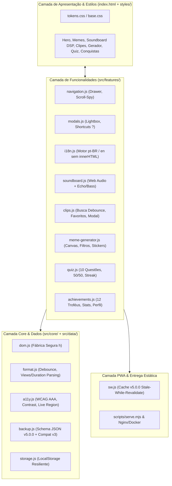
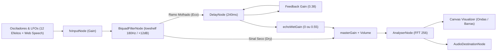
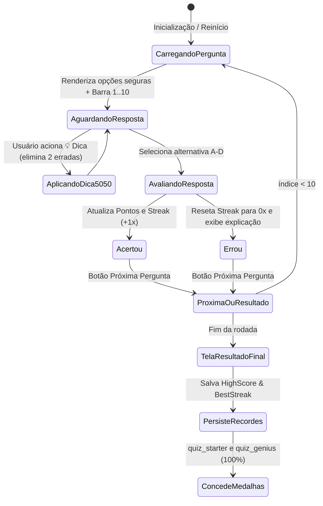

# 🏛️ Arquitetura do Sistema — Alanverso v5.0.0

Este documento apresenta a especificação arquitetural completa do **Alanverso v5.0.0**, detalhando a divisão em módulos ES nativos, construção de DOM segura anti-XSS (`h()` e parser de fragmentos), cadeia DSP de efeitos Web Audio API, máquina de estados do Quiz com dicas 50/50 e combo de acertos, Central de Clipes com favoritos persistentes, conformidade WCAG 2.2 AAA e estratégia PWA Offline-First.

---

## 1. Visão Geral em Camadas

O Alanverso v5.0.0 abandona scripts monolíticos em prol de camadas estritas com zero dependências externas de produção:

---

## 2. Cadeia de Processamento de Áudio DSP (Web Audio API v5.0.0)

O módulo `src/features/soundboard.js` constrói um grafo de áudio real em tempo real com efeitos encadeados sem alterar a nitidez dos osciladores base:

---

## 3. Máquina de Estados do Quiz Interativo v5.0.0

Opera com 10 perguntas, contador de sequência (`streak`), sistema de dica **50/50** (máximo 2 por partida) e gravação de recorde e maior combo no `localStorage`:

---

## 4. Pipeline de Central de Clipes e Correções v5.0.0

Em versões anteriores, seletores incorretos e parsing de string prejudicavam a busca e ordenação. Na v5.0.0, o módulo `src/features/clips.js` e `src/core/format.js` garantem precisão matemática:

1. `parseViewsCount("1.4M visualizações")` → `1400000` (ordenando corretamente acima de `"890K views"` → `890000`).
2. `parseDurationSeconds("1:15")` → `75` segundos inteiros.
3. Suporte nativo a **Favoritos de Clipes** (`⭐`) com aba dedicada de filtragem e restauração do estado vazio (`#clips-empty-state` + `#clips-reset-filter`).

---

## 5. Segurança Anti-XSS & Auditoria Automatizada

A arquitetura garante proteção estrutural verificada automaticamente pelo teste [tests/security.test.js](./tests/security.test.js):

- **Zero Sinks de HTML Inseguro**: Proibido o uso de `innerHTML`, `outerHTML`, `insertAdjacentHTML` ou `document.write` em `src/`.
- **Construção Declarativa**: Listas de conquistas (`achievements.js`) e opções de Quiz (`quiz.js`) são montadas via `h()` usando `document.createElement` e `textContent`.
- **Tradução Rica Segura**: String i18n com tags inline simples (como ``) é tokenizada manualmente em `buildSafeRichFragment()` dentro de `src/core/dom.js`, ignorando scripts e atributos perigosos sem usar parser HTML inseguro.
- **Servidor Dev Blindado**: `scripts/serve.mjs` implementa allowlist estrita de caminhos públicos (`/index.html`, `/src/`, `/styles/`, etc.), impedindo vazamento de arquivos privados ou *path traversal*.
